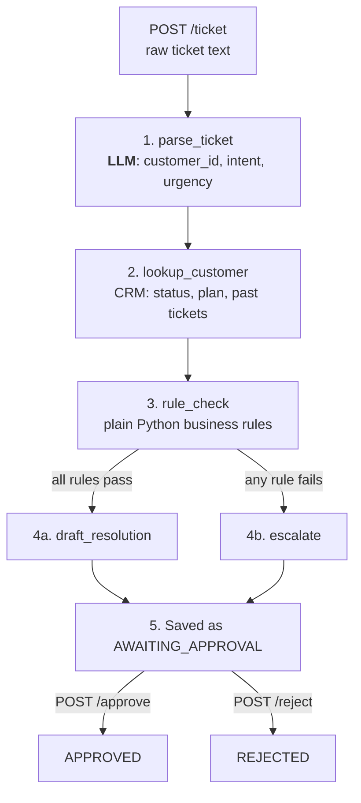

# Ticket Triage Agent

A LangGraph agent that reads a customer support ticket, checks the customer in a CRM, applies business rules, and proposes an action: either a drafted resolution or an escalation to a human. Every proposal waits for a human to approve or reject it.

The design rule: **the LLM interprets, deterministic code decides.** The model only turns messy ticket text into structured fields. The CRM lookup, the rule checks, the routing and the proposed action are all plain Python, so the outcome for a given set of facts is predictable and testable.

## How it works



The branch at step 3 is a LangGraph **conditional edge**: the path through the graph depends on what earlier nodes found. That branching is why this uses LangGraph instead of plain functions calling each other.

| Step | Node | LLM? | What it does |
|---|---|---|---|
| 1 | `parse_ticket` | Yes | Extracts `customer_id`, `intent`, `urgency` as JSON |
| 2 | `lookup_customer` | No | Reads account status, plan tier and ticket history from SQLite. Unknown customers get an explicit `UNKNOWN`, never a guess |
| 3 | `rule_check` | No | Applies the business rules and collects **every** violation |
| 4a | `draft_resolution` | No | Template-based proposed action for clean tickets |
| 4b | `escalate` | No | Hands off to a human with the list of reasons |
| 5 | API + `store.py` | No | Saves the result; a human approves or rejects it |

### Business rules

A ticket is escalated if any of these is true:

- Account is `DELINQUENT`, `SUSPENDED`, or not found in the CRM
- Urgency is `HIGH`, or the model returned an urgency that isn't `LOW`/`MEDIUM`/`HIGH` (fails safe)
- The customer has more than 10 past tickets
- A refund is requested on a `FREE` plan

Thresholds live as constants at the top of `graph.py`.

## Example

Input:

> Hi, this is customer C-1002. I was charged twice for my subscription this month and need a refund for the duplicate charge.

Output (abridged):

```json
{
  "ticket_id": "T-3F9A1C2B",
  "status": "AWAITING_APPROVAL",
  "agent_result": {
    "customer_id": "C-1002",
    "intent": "refund request",
    "urgency": "MEDIUM",
    "account_status": "DELINQUENT",
    "plan_tier": "PRO",
    "past_tickets": 12,
    "rules_passed": false,
    "rule_violations": [
      "Account is DELINQUENT",
      "12 past tickets (auto-resolve limit is 10)"
    ],
    "route": "escalate",
    "draft_action": "Escalate C-1002 to a human agent",
    "reasoning": "Rules failed: Account is DELINQUENT; 12 past tickets (auto-resolve limit is 10)"
  }
}
```

The same request from C-1001 (active Enterprise account, 3 past tickets) routes to `draft_resolution` instead.

## Project structure

| File | Purpose |
|---|---|
| `graph.py` | State definition, the five nodes, and the graph wiring |
| `db.py` | Seeds `crm.db`, a SQLite stand-in for a real CRM (5 fake customers) |
| `store.py` | Saves processed tickets to `tickets.db` and handles approve/reject |
| `app.py` | FastAPI app exposing the agent and the approval flow |
| `check_models.py` | Lists the Groq models your API key can use |
| `tests/` | 37 pytest tests covering rules, routing, and the API (no LLM calls) |

## Running it

Requires Python 3.10+ and a [Groq](https://console.groq.com) API key.

```powershell
python -m venv venv
.\venv\Scripts\Activate.ps1          # macOS/Linux: source venv/bin/activate
pip install -r requirements.txt

$env:GROQ_API_KEY = "gsk_..."         # macOS/Linux: export GROQ_API_KEY=gsk_...
python db.py                          # create the mock CRM

python graph.py                       # run four sample tickets in the terminal
uvicorn app:app --reload              # or start the API
```

Open http://127.0.0.1:8000 for the interactive API docs.

If Groq reports the model is unavailable, run `python check_models.py` and set `$env:GROQ_MODEL` to one from the list.

## API

| Method | Path | Purpose |
|---|---|---|
| `POST` | `/ticket` | Run a ticket through the agent; saved as `AWAITING_APPROVAL` |
| `GET` | `/tickets?status=AWAITING_APPROVAL` | The review queue (filter optional) |
| `GET` | `/ticket/{id}` | One ticket with its full decision trail |
| `POST` | `/ticket/{id}/approve` | Approve, with an optional `{"note": "..."}` |
| `POST` | `/ticket/{id}/reject` | Reject, with an optional note |
| `GET` | `/health` | Server check |

A ticket can be decided once. A second approve/reject returns `409 Conflict`, and the update only matches pending rows, so two reviewers acting at the same moment can't both succeed. If the LLM call fails, the API returns `502` and saves nothing.

## Tests

```powershell
pytest
```

The tests replace only the LLM node with a stub (via `build_graph(parse_node=...)`) and use temporary databases, so they run in under a second, cost nothing, and give the same result every time. They cover each rule and its boundary, the router, every mock customer's path through the real graph, and the full approval lifecycle.

## Design decisions

- **LLM only at the edge.** Model output varies run to run (the same ticket might come back as `"login issue"` or `"access problem"`), but no decision depends on that wording. The rules read structured fields, and anything unexpected escalates.
- **Fail safe, not fail open.** Unknown customers, missing urgency, or an LLM error all lead to escalation or an error, never to an auto-drafted action.
- **Every violation is reported.** The reviewer sees all the reasons, not just the first one hit.
- **Human in the loop by construction.** No path through the graph ends without `AWAITING_APPROVAL`.
- **Separate stores.** `crm.db` is mock reference data and can be reseeded freely; `tickets.db` holds the audit trail and is never touched by `db.py`.
